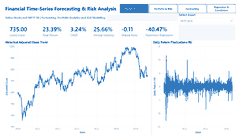
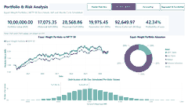
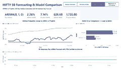
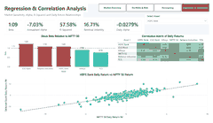

# 📈 Stock Market Analytics & Time-Series Forecasting

An end-to-end **financial analytics and forecasting project** focused on the Indian equity market. This project analyzes five large-cap Indian stocks against the NIFTY 50 benchmark, evaluates portfolio performance and risk, compares ARIMA and Prophet forecasting models, and applies regression, correlation analysis, and Monte Carlo simulation.

---

## 🎯 Project Objectives

- 📊 Analyze historical prices and returns for five Indian equities and NIFTY 50.
- 💰 Evaluate portfolio performance against the market benchmark.
- ⚖️ Measure risk using volatility, Sharpe ratio, maximum drawdown, VaR, and CVaR.
- 🔮 Compare ARIMA and Prophet time-series forecasting models.
- 📉 Analyze market sensitivity through regression, beta, alpha, and R-squared.
- 🔗 Examine relationships between stocks using correlation analysis.
- 📊 Build interactive Power BI dashboards for financial reporting and decision support.

## 🧭 Executive Summary

The project combines Python-based financial analysis, statistical modeling, risk assessment, and Power BI visualization to understand historical market behavior and evaluate potential portfolio outcomes.

The analysis covers **HDFC Bank, ICICI Bank, Infosys, Reliance Industries, and TCS**, using NIFTY 50 as the benchmark. An equal-weight portfolio is evaluated alongside forecasting models and risk simulations.

### 💡 Highlights at a Glance

| Indicator | Project Result |
|---|---:|
| Assets analyzed | 5 stocks + NIFTY 50 |
| Portfolio allocation | 20% per stock |
| Initial portfolio value | ₹10,00,000 |
| Monte Carlo simulations | 10,000 |
| Simulation horizon | 30 trading days |
| Best-performing evaluated forecast | ARIMA |
| ARIMA MAPE | 2.26% |
| Prophet MAPE | 7.14% |

## 🏢 Assets Analysed

| Asset | Purpose |
|---|---|
| HDFC Bank | Banking equity analysis |
| ICICI Bank | Banking equity analysis |
| Infosys | IT sector analysis |
| Reliance Industries | Diversified business analysis |
| TCS | IT sector analysis |
| NIFTY 50 | Market benchmark |

**📅 Study period:** January 2020 – September 2026, based on the configured data extraction period.

**💼 Portfolio strategy:** Equal-weight allocation of 20% to each of the five equities.

## 🛠️ Tools & Technologies

- 🐍 **Python** – Core analysis and financial calculations
- 🧮 **Pandas & NumPy** – Data manipulation and numerical analysis
- 📥 **yfinance** – Historical market data retrieval
- 📈 **Matplotlib** – Data visualization
- 📉 **Statsmodels** – ARIMA forecasting and regression
- 🔮 **Prophet** – Time-series forecasting
- 🧪 **Scikit-learn** – Forecast evaluation metrics
- 📊 **Power BI** – Interactive dashboards and reporting
- 📁 **Excel / CSV** – Data export and analytical outputs

## 🔄 Analytical Workflow

1. 📥 **Data Collection** – Retrieve historical price data for the selected equities and NIFTY 50.
2. 🧹 **Data Preparation** – Process dates, align observations, and prepare adjusted closing prices.
3. 🔍 **Exploratory Analysis** – Examine price trends, returns, and asset relationships.
4. 💼 **Portfolio Analysis** – Construct an equal-weight portfolio and compare it with NIFTY 50.
5. ⚠️ **Risk Assessment** – Calculate volatility, Sharpe ratio, maximum drawdown, VaR, and CVaR.
6. 🎲 **Monte Carlo Simulation** – Simulate 10,000 possible portfolio outcomes over 30 trading days.
7. 🔮 **Forecasting** – Compare ARIMA and Prophet using a 60-observation holdout set.
8. 📉 **Regression Analysis** – Evaluate beta, alpha, R-squared, and residual volatility.
9. 📊 **Dashboard Development** – Present the findings through interactive Power BI reports.

## 📊 Power BI Dashboard

### 1️⃣ 📈 Market Overview

Explore individual asset performance through interactive price history, daily returns, total return, CAGR, volatility, Sharpe ratio, and maximum drawdown.



### 2️⃣ 💼 Portfolio & Risk Analysis

Compare equal-weight portfolio performance with NIFTY 50, explore portfolio allocation, assess VaR/CVaR, and examine simulated outcomes from 10,000 Monte Carlo paths.



### 3️⃣ 🔮 Forecasting & Model Comparison

Compare ARIMA and Prophet using holdout error metrics and review the 30-business-day ARIMA forecast with its 95% confidence interval.



### 4️⃣ 📉 Regression & Correlation Analysis

Explore stock-market sensitivity through beta, alpha, R-squared, residual volatility, market-beta comparisons, return correlations, and an interactive regression scatter plot.



## 📌 Key Results & Insights

### 💹 1. Portfolio Performance

| Metric | Equal-Weight Portfolio | NIFTY 50 |
|---|---:|---:|
| Total Return | 95.93% | 102.13% |
| Reported Annual Return | 10.74% | 11.27% |
| Annualized Volatility | 19.75% | 17.89% |
| Sharpe Ratio | 0.2400 | 0.2943 |
| Maximum Drawdown | -37.31% | -38.44% |

**🔎 Insight:** The portfolio generated positive cumulative returns but underperformed NIFTY 50 in total return and reported annual return. It experienced higher volatility and a lower Sharpe ratio, while its maximum drawdown was less severe than the benchmark's.

### ⚠️ 2. Risk Analysis

| Measure | Reported Result |
|---|---:|
| Historical 95% one-day VaR | ₹17,075 |
| Historical 95% one-day CVaR | ₹28,569 |
| Parametric VaR | ₹19,975 |
| Monte Carlo probability of loss | 42.34% |
| 30-day Monte Carlo VaR | ₹92,650 |
| 30-day Monte Carlo CVaR | ₹1,18,592 |

**🔎 Insight:** The Monte Carlo simulation estimated a 42.34% probability of the portfolio ending below its initial value over 30 trading days. This highlights the importance of considering downside risk alongside expected returns.

*Note: VaR/CVaR figures use different horizons and potentially different sign conventions. Interpret them according to the calculation implemented in the project.*

### 🔗 3. Correlation & Regression

Selected correlations:

| Asset Pair | Correlation |
|---|---:|
| Infosys – TCS | 0.73 |
| HDFC Bank – NIFTY 50 | 0.76 |
| ICICI Bank – NIFTY 50 | 0.76 |
| Reliance Industries – NIFTY 50 | 0.71 |
| Infosys – NIFTY 50 | 0.57 |
| TCS – NIFTY 50 | 0.55 |

HDFC Bank regression against NIFTY 50:

| Metric | Result |
|---|---:|
| Beta | 1.09 |
| Annualized Alpha | -7.03% |
| R-squared | 57.58% |
| Residual Volatility | 16.71% |

**🔎 Insight:** Infosys and TCS had a strong positive return correlation of 0.73 in the analyzed sample. HDFC Bank's beta of 1.09 indicated greater historical sensitivity to benchmark movements than a beta of 1, while its R-squared showed that the regression explained approximately 57.58% of return variation.

### 🔮 4. Forecasting Model Comparison

| Metric | ARIMA(0,1,0) | Prophet |
|---|---:|---:|
| MAPE | 2.26% | 7.14% |
| RMSE | 626.68 | 1,735.80 |
| MAE | 544.30 | 1,705.80 |

**🔎 Insight:** ARIMA achieved lower MAPE, RMSE, and MAE than Prophet on the 60-observation holdout set. It was the better-performing model for this evaluation period, although performance may differ on other datasets or time periods.

## 🧮 Financial Metrics Explained

| Metric | What It Measures |
|---|---|
| Total Return | Cumulative investment growth |
| CAGR | Annualized compounded growth |
| Volatility | Variability of returns |
| Sharpe Ratio | Excess return per unit of volatility |
| Maximum Drawdown | Largest peak-to-trough decline |
| VaR | Estimated loss threshold at a selected confidence level |
| CVaR | Average loss beyond the VaR threshold |
| Beta | Sensitivity to benchmark returns |
| Alpha | Regression-estimated return component not explained by the benchmark |
| R-squared | Proportion of return variation explained by the regression |
| MAPE | Mean absolute percentage forecast error |
| RMSE | Root mean squared forecast error |
| MAE | Mean absolute forecast error |

## 📂 Repository Structure

```text
Stock-Market-Analytics/
│
├── dashboard/
│   └── Power BI dashboard file(s)
│
├── Exported Data/
│   └── CSV and Excel analytical outputs
│
├── Images/
│   └── Dashboard screenshots and supporting images
│
├── python/
│   └── Python notebooks and analysis scripts
│
├── Report/
│   └── Project report and documentation
│
└── README.md
```

## ⚠️ Limitations

- Historical performance does not guarantee future returns.
- Forecast results depend on the selected holdout period and model assumptions.
- Monte Carlo outcomes depend on the implementation and assumptions about returns.
- VaR does not capture the full magnitude of losses beyond its threshold.
- Correlation does not establish causation.
- Regression results depend on the selected sample period and model specification.
- Transaction costs, taxes, and rebalancing should be considered before applying the analysis to a real portfolio.

## 🌱 Future Improvements

- Add rolling-window or walk-forward forecast validation.
- Evaluate additional forecasting models.
- Introduce portfolio optimization and periodic rebalancing.
- Add transaction costs and tax assumptions.
- Conduct stress testing and sensitivity analysis.
- Automate data refresh and dashboard reporting.


